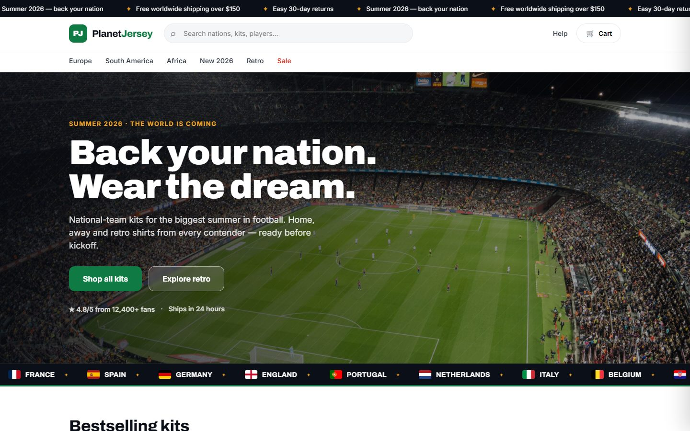
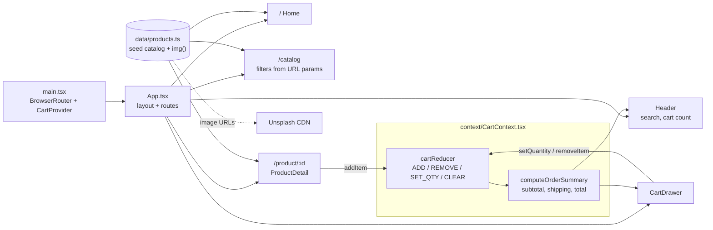

# Planet Jersey

**A World Cup 2026 football-kit storefront.** Home, away and retro national-team shirts, built frontend-first with Vite, React and TypeScript.

[](https://github.com/LuisEduardoGE/planetjersey/actions/workflows/ci.yml)
[](LICENSE)




The catalog runs on local seed data, with a data shape designed to swap to a real API (e.g. FastAPI) without rewriting the UI.

## Table of Contents

- [Features](#features)
- [Tech Stack](#tech-stack)
- [Architecture](#architecture)
- [Quick Start](#quick-start)
- [Testing](#testing)
- [Project Structure](#project-structure)
- [Roadmap](#roadmap)
- [Author](#author)
- [License](#license)

## Features

- **Storefront homepage**: stadium hero, bestsellers, shop-by-region tiles, editorial band, reviews, newsletter.
- **Catalog** with URL-driven filters (region, badge such as New or Retro, sale), search, and sorting by price or rating.
- **Product detail**: large imagery, ratings, sale pricing, size selector, expandable details / shipping / returns, "you may also like".
- **Cart drawer** with quantity controls, live totals and a free-shipping progress nudge.
- **Trust and conversion layer**: announcement bar, trust badges, payment icons, rich footer.
- Fully **responsive** (desktop / tablet / mobile), with an Archivo + Inter type system.

## Tech Stack

| Layer | Choice |
|---|---|
| Build | Vite 5 |
| UI | React 18 + TypeScript 5 (strict) |
| Routing | React Router 6 |
| State | React Context + `useReducer` |
| Styling | Hand-written CSS (`src/index.css`) |
| Tests | Vitest 3 |
| Images | Unsplash CDN, sized per surface by `img()` |

## Architecture



The app is a single-page React store with no backend yet. Pages read the catalog from `src/data/products.ts`, whose `Product` shape mirrors a future `/api/products` response, so adding an API is a data-source change. Cart state lives in one reducer behind React Context, and every price shown in the UI comes from `computeOrderSummary()` (flat 9.99 shipping, free from 150), so a pricing-policy change is a single edit.

## Quick Start

Prerequisites: Node.js 18+ (CI uses Node 22), npm, and `make` (optional).

```bash
make install     # npm ci
make run         # Vite dev server on http://localhost:5180 (PORT=... to change)
```

Without make:

```bash
npm install
npm run dev                      # http://localhost:5173
npm run build && npm run preview # production build
```

Or `python run.py`, which installs dependencies if needed and starts the dev server.

Run `make` with no arguments to list all targets (`install`, `run`, `test`, `lint`, `build`, `preview`, `clean`).

## Testing

```bash
make test        # npm test (vitest run)
make lint        # tsc --noEmit
make build       # tsc -b && vite build
```

16 tests in 2 files cover the pure logic: the cart reducer (add, merge, per-size lines, set quantity, remove, clear), the order summary and free-shipping threshold, catalog data integrity (unique ids, prices, ratings, sizes), `getProductById` and the `img()` URL builder. CI runs type-check, tests and build on every push and pull request to `master`.

## Project Structure

```
src/
├── main.tsx              # entry: Router + CartProvider
├── App.tsx               # shell: navbar, routes, cart drawer, footer
├── index.css             # all styles
├── types/                # Product, CartItem, Region, Kit
├── data/products.ts      # seed catalog (swap for an API later)
├── context/CartContext   # cart state + pricing rules
├── components/           # Header, TrustBar, Footer, ProductCard, CartDrawer, ...
└── pages/                # Home, Catalog, ProductDetail
docs/screenshot.jpg       # README screenshot
run.py                    # one-command dev launcher
.env.example              # reserved for a future VITE_API_BASE_URL (nothing is read yet)
```

**Where the business logic lives:** pricing rules (subtotal, shipping, free-shipping threshold) are in one function, `computeOrderSummary()` in `src/context/CartContext.tsx`. Every UI surface reads from it, so a pricing-policy change is a single edit.

## Roadmap

- [ ] Real backend (FastAPI) behind `/api/products`
- [ ] Checkout and payments (Stripe)
- [ ] Multiple photos per kit
- [ ] Player name / number customisation
- [ ] Persist the cart to `localStorage`
- [ ] i18n (EN / FR / NL)

## Author

**Luis Eduardo G. Espindola** · [GitHub](https://github.com/LuisEduardoGE) · [LinkedIn](https://www.linkedin.com/in/luisgespindola/)

## License

[MIT](LICENSE) © Luis Eduardo G. Espindola

Photography is from [Unsplash](https://unsplash.com) under the Unsplash License. Planet Jersey is a demo store: team names are used descriptively and no official kits are sold.
